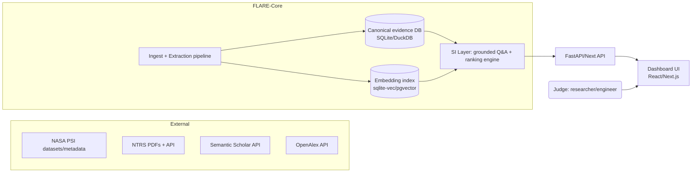

# PROJECT ARCHITECTURE SPEC — Flight-ready design for "Flame in Freefall"
Project codename: **FLARE — Freefall Lab Analysis & Ranking Engine**
This doc is written so a dev who never saw the chat can BUILD the project from it on Nov 14.

---

## 0. One-paragraph vision
FLARE ingests NASA PSI (experiment datasets + metadata) and NTRS (full texts of every related report/paper), normalizes them into one structured evidence graph, then runs an SI (LLM-powered) layer that **summarizes, ranks, and interprets** every investigation against the fire-safety needs of crewed environments — ISS, Lunar Gateway/Moon Base (30% O2 / 10.2 psi), pressurized rovers, spacesuits (100% O2 / 4.3 psi), Mars transit — and renders it in a dashboard where **every AI claim is click-through-able to its source experiment or PDF page**.

## 1. System context (who/what touches it)



## 2. Data pipeline (the boring part that makes the wow possible)

### 2.1 Stage A — Investigation registry
One row per PSI investigation (source of truth: PSI portal, Nov 13 resource list, NTRS).
Schema-driven fields copied from challenge "Potential considerations" §2-3 — the challenge literally tells us which attributes matter (objectives, fuels/shape/size, O2, airflow, variables, sensors, similarities/differences between investigations).

### 2.2 Stage B — Evidence extraction (LLM-assisted, human-corrected)
- Ingest NTRS PDFs (we ALREADY have 75 public-domain ones in research/papers/) + PSI experiment pages.
- LLM extraction run with a JSON-schema prompt → `test_runs` rows: fuel type/geometry/thickness, O2%, pressure, flow speed, gravity level, extinguishing medium, key quantitative findings (heat release rate, flame spread rate, extinction limit, particle size distribution...).
- **Extraction confidence flag**: each row marked `verified: llm_manual | llm_auto` — judges LOVE honesty about pipeline quality. We hand-verify the Top 12 investigations.

### 2.3 Stage C — Text index
- Chunk PDFs (~500 tok, page-indexed) → embeddings (any: text-embedding-3-small / local bge-small) → sqlite-vec.
- Store page numbers so citations resolve to "BASS-II TM, p.14".

## 3. Canonical data model (build exactly this)

```sql
investigations(id PK, name, acronym, project_family, platform,       -- BASS, SAFFIRE-I...
               rack, pi_team, start_end_dates, objectives,          -- MSG / CIR / Cygnus
               fire_phase,                                            -- prevent | detect | suppress
               psi_url, ntrs_url, data_status,                        -- psi/open | future(LUCI/FM2)
               summary_short, summary_long, earth_apps)

tests(id PK, investigation_id FK, test_label,                        -- "FLEX-2 test 47"
      fuel_type,                                                     -- PMMA/silicone/SIBAL/heptane...
      fuel_form,                                                     -- rod/slab/sphere/droplet/thin-thick
      oxygen_pct, pressure_psia, flow_speed_cms, gravity_level,      -- micro | 1g | lunar (est)
      extinguishant, sensors,                                        -- CSA-CP, CDM, MCA...
      key_result, key_value, units,                                  -- extinction at 16% O2...
      configured_variables,                                          -- what differed within investigation
      citation_ref,                                                  -- FK -> citations
      verified)

citations(id PK, investigation_id FK, type,                          -- TM | ICES | journal | PSI-dataset
          title, authors, year, url, pdf_path, pages_ref)

rankings(id PK, investigation_id FK, environment_id FK,
         score, score_breakdown_json, why_ranked, generated_at)      -- SI-generated + cached

environments(id PK, name, o2_pct, pressure_psia, gravity, notes)     -- scenario presets:
-- ISS: ~21% O2, 14.7 psi, micro ; Moon Base: ≥30% O2, ≤10.2 psi, ~0.165g  (challenge text: defensible)
-- Suit: 100% O2, 4.3 psi (challenge text) ; Rover: intermediate, TBD live on site
-- Mars transit: ~26% O2, ~8.2 psi (ASSUMED from NASA literature — verify or drop before submission)

findings(id PK, investigation_id FK, title, insight,                  -- SI-generated insight cards
         evidence_ids json, environment_tags, quote_spanref)
```

## 4. The Ranking Engine (the "SI-powered" differentiator, fully explainable)

**Not vibes — a transparent weighted rubric + LLM narrative justification with citations.**

```
Score(i, E) = w1·Phase match       (prevent/detect/suppress relevance to E)
            + w2·Environment match (O2/pressure proximity of tested conditions to E's planned atmos)
            + w3·Data openness      (PSI data downloadable > partial > none=0)
            + w4·Recency & scale    (flight ISS/large-scale > ground)
            + w5·Direct applicability(i, E)  -- LLM rates how directly the tested conditions/materials map to environment E
```
- Show breakdown bars per factor in UI ("why ranked"), because explainability = trust = judges.
- Same score engine in API = cacheable = snappy demo.
- LLM writes the `why_ranked` 2-sentence justification, MUST cite investigation + readable quote.

## 5. The SI Layer
Two modes, both citation-grounded-or-refused:
1. **Ranked Brief** (pre-computed): per environment, ranked list + extractive summaries per investigation.
2. **Ask-FLARE** (interactive NL query): typed question → route to (a) filters over DB, (b) text retrieval over chunk index, (c) generate with "ANSWER + EVIDENCE[]" schema; **render rule: a claim without ≥1 citation span doesn't render** (UI literally shows 🔗 chips).
Guardrails: refusal template for out-of-corpus Qs (rocket combustion — challenge explicitly says out of scope); "no data on partial-g yet, bounding needed" cards → flagship honesty feature.

## 6. Frontend (pages/features → mapped to challenge Objectives)

| Feature | Maps to Challenge Objective | Notes |
|---|---|---|
| **Scenario selector** (ISS/Moon Base/Rover/Suit/Mars transit) | "identify investigations relevant to habitable crew environments" | Hero feature |
| **Ranked evidence list** with score breakdowns | objective 1 | + #PSI-downloaded badges |
| **Investigation matrix** (compare BASS vs FLEX vs ACME: fuels, O2 range, flow, results) | "similarities and differences between investigations" (§3) | table + radar chart |
| **Test-parameter explorer** (dot-plot: spread/extinction vs O2%, flow, per fuel) | "extract data for predictive modeling" | CSV export button |
| **Bounding panel**: µg vs 1g boundaries + slider for lunar-g interpolation (every curve labeled "bounded interpolation, not measurement"); anchored by E-FIELD partial-g-proxy caveat + 2024–26 NTRS partial-gravity papers (LUCI rocket, FM2, lunar/Martian-gravity study) | stretch goal / signature wow | challenge explicitly invites bounding; PSI lacks partial-g datasets but NTRS has fresh papers |
| **Ask-FLARE** chat with click-through citations | general interpret | the "SI" |
| **Prevent/Detect/Suppress phase lenses** | NASA fire-safety triad | tab taxonomy |
| **Earth applications page** (water-mist, smoke detection, gear) | bonus in challenge text | 3 cards |
| **Timeline strip** (Apollo 1→Mir→BASS→SAFFIRE→Artemis II smoke-alarm incident) | narrative hook | re-tells history → justifies urgency |

Tech stack (recommended): Next.js 14 + TypeScript + shadcn/Tailwind + recharts/ECharts; FastAPI + SQLite + sqlite-vec; LLM: GPT-class API + one local fallback model; charts must be readable on projector.

## 7. API surface (sketch)
```
GET /api/investigations?phase=&environment=&q=
GET /api/investigations/{id}          (incl. tests, citations, insights)
POST /api/rank                        {environment_id} -> ranked+why
GET /api/tests?fuel=&o2min=&o2max=&flow=...
POST /api/ask                         -> async SSE stream, returns claims+citations
GET /api/export?investigation=|filter= -> CSV (predictive-modeling objective)
```

## 8. Risks & mitigations
- PSI AWS bulk access unclear → fallback: manual per-investigation downloads (already curated top PDFs) + NTRS API (proven).
- LLM hallucination → citation-or-no-render rule + verified manual Rows for Top-12.
- 48h time → pre-modeled schema + pre-downloaded corpus + this runbook (see BUILD-RUNBOOK.md).
- Partial-g data: PSI has no partial-g *datasets* → feature: honest bounding panel; we also discovered 2024–26 NTRS *papers with partial-g flammability results* (LUCI rocket, FM2, lunar/Martian-gravity) → turns the gap into a differentiator.

## 9. Demo script (90 sec, projector-ready)
1. "Artemis II: smoke alarm 80k miles from home. What does 50 years of flight data say?" (timeline beat)
2. Click Moon Base scenario → ranked investigations with why-citations.
3. Open #1 (BASS-II): matrix view → extinction column highlighted at 30% O2 extrapolation (labeled).
4. Ask-FLARE: "What suppression method is proven at low flow in microgravity?" → grounded answer w/ 3 chips.
5. Bounding panel reveal: lunar-g interpolated envelope + E-FIELD citation.
6. Earth apps beat → water mist. Close: "PSI stores data — we deliver decisions."

## 10. Feature depth ladder
Feature build-order and depth (T0→T3 passports: what/why/how/kill-order) — see `FEATURE-LADDER.md`. The rule: basics thin, advanced thick — ranked view + citations + matrix are T1 floors; hybrid retrieval, parameter-predictive views, lunar-g bounding, and the SI self-audit harness are where the 48 hours go.
